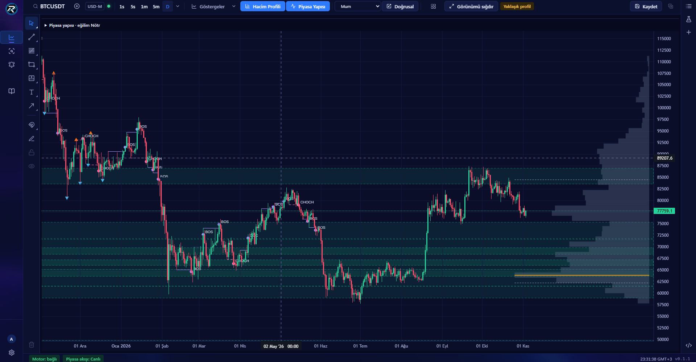

<div align="center">


# RVLX Charts

**Binance piyasasını kendi ekranınızda izleyin, çizin ve stratejinizi deneyin.**

<a href="https://www.arvelx.com/urunler/rvlx-charts"></a> <a href="https://github.com/tlgtrzi-code/RVLX-Charts/releases/latest"></a> 

</div>

---

<div align="center">

</div>

Windows için canlı grafik, gösterge, kalıcı çizim ve kod yazmadan strateji. Çizimleriniz ve çalışma alanınız bilgisayarınızda kalır, kendiliğinden kaydedilir.

> **Uyarı.** RVLX Charts bir analiz yazılımıdır; yatırım danışmanlığı veya portföy yöneticiliği değildir. Strateji raporları geçmiş veride yapılan denemelerdir ve gelecekteki sonucu göstermez. Kaybetmeyi göze alamayacağınız tutarla işlem yapmayın.

## ✨ Neler yapar

- 📈 **Canlı grafik** — Binance Spot ve USD-M Vadeli. 1 saniyeden 1 aya kadar zaman dilimleri, on grafik türü ve 8 grafiğe kadar çoklu düzen.
- 📊 **Göstergeler ve analiz** — EMA, RSI, MACD, Bollinger, VWAP ve CVD. Hacim profili, piyasa yapısı ve sembol karşılaştırma aynı grafikte.
- ✏️ **Kalıcı çizimler** — trend, Fibonacci, kanal, pitchfork ve metin. Çizimler sembole aittir ve her zaman diliminde görünür.
- 🧪 **Kodsuz strateji** — giriş ve çıkışı Türkçe kurallarla seçin; kâr al ve zarar durdur zorunlu. Strateji Laboratuvarı işlemleri grafiğe işler ve raporu verir.
- 💾 **Sizde kalan kayıt** — çizimler, çalışma alanı ve indirilen piyasa verisi arşivi Windows kullanıcı klasörünüzde durur.

## 🔑 Lisans

RVLX Charts ARVELX hesabınız ve lisansınızla açılır. Ücretsiz deneme yoktur. Lisans tek bilgisayar içindir. Fiyatlar: **[arvelx.com/fiyatlandirma](https://www.arvelx.com/fiyatlandirma)** · Lisans: **[arvelx.com/lisans-al/rvlx-charts](https://www.arvelx.com/lisans-al/rvlx-charts)**

## 📦 İndirme ve doğrulama

1. **[Releases](https://github.com/tlgtrzi-code/RVLX-Charts/releases/latest)** bölümünden `RVLX-Charts-Setup-<sürüm>.exe` dosyasını indirin.
2. Dosyayı sürümle gelen `SHA256SUMS.txt` ile doğrulayın:

   ```powershell
   Get-FileHash .\RVLX-Charts-Setup-1.0.0.exe -Algorithm SHA256
   ```

   Çıkan değer `SHA256SUMS.txt` içindekiyle aynı olmalıdır.
3. Kurun (Windows 10/11, 64 bit). Uygulama sonraki sürümleri kendisi bulur; çizimleriniz ve çalışma alanınız korunur.

## 🧩 Diğer ARVELX ürünleri

| | Ürün | |
|---|---|---|
| 🤖 | **RVLX AI** — modeller tartışır, hakemler karar verir (Windows) | [Sürümler](https://github.com/tlgtrzi-code/RVLX-AI) · [Ürün sayfası](https://www.arvelx.com/urunler/rvlx-ai) |
| 🧾 | **RVLX Kasa** — kasa, fatura ve raf yönetimi (Windows) | [Sürümler](https://github.com/tlgtrzi-code/RVLX-Kasa) · [Ürün sayfası](https://www.arvelx.com/urunler/rvlx-kasa) |
| 📱 | **RVLX Media** — tarayıcı, indirici ve müzik çalar (Android) | [Sürümler](https://github.com/tlgtrzi-code/RVLX-Media) · [Ürün sayfası](https://www.arvelx.com/urunler/rvlx-media) |
| 💻 | **RVLX Media Desktop** — hızlı indirme yöneticisi (Windows) | [Sürümler](https://github.com/tlgtrzi-code/RVLX-Media-Desktop) · [Ürün sayfası](https://www.arvelx.com/urunler/RVLX-Media-Desktop) |

## ℹ️ Bu depo hakkında

Bu depo RVLX Charts'ın **genel dağıtım** noktasıdır: kurulum dosyası, sürüm notları ve doğrulama değerleri **Releases** bölümünde yayınlanır. Kaynak kod burada bulunmaz.

Destek: **[arvelx.com/iletisim](https://www.arvelx.com/iletisim)** · [Facebook](https://www.facebook.com/Arvelx/) · [Instagram](https://www.instagram.com/arvelxai/) · [YouTube](https://www.youtube.com/@Arvelx-RVLX)

<div align="center">
<br>
<a href="https://www.arvelx.com"></a>
<br><sub>© ARVELX · RVLX ürün ailesi</sub>
</div>
